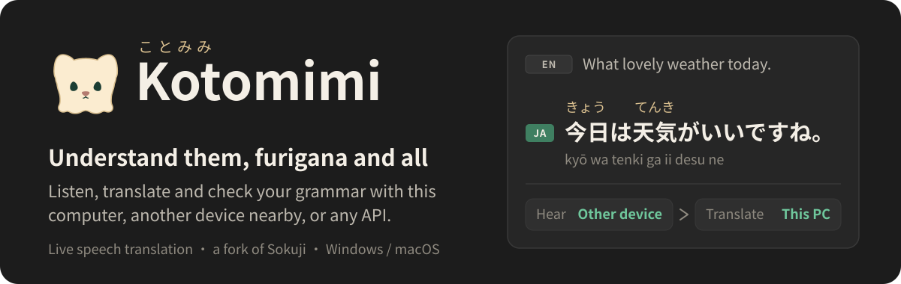
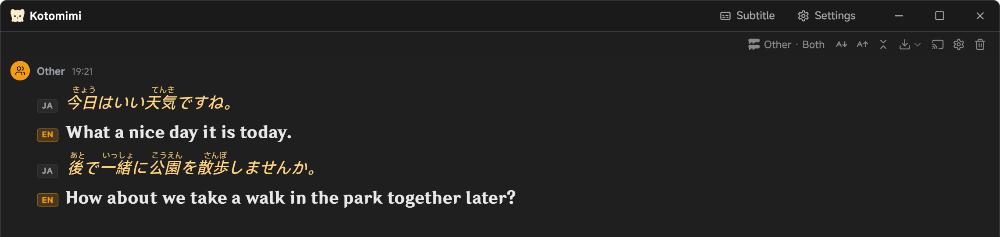
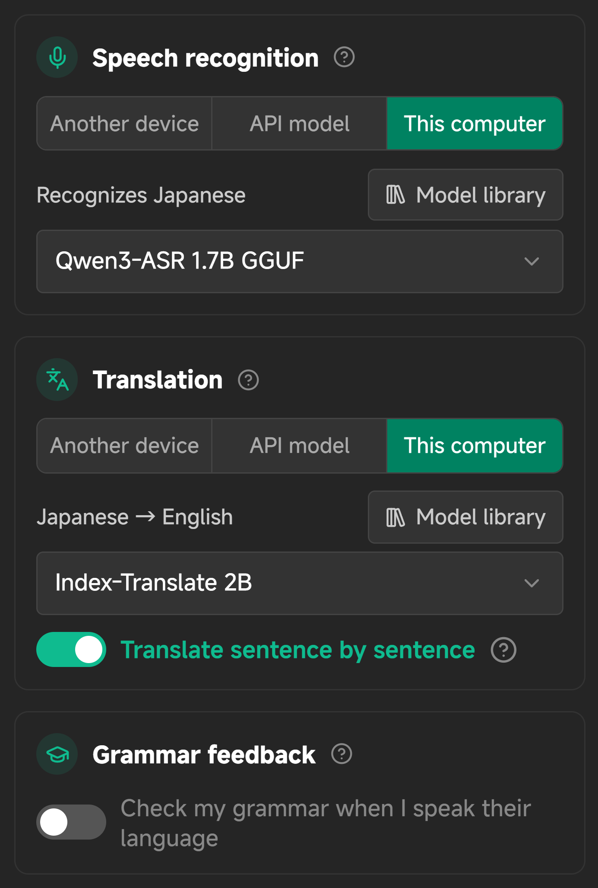
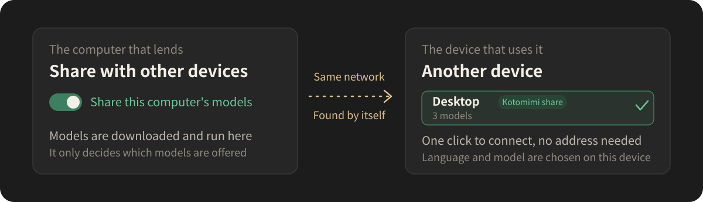
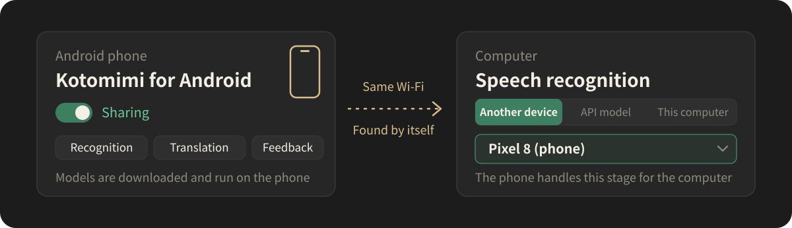
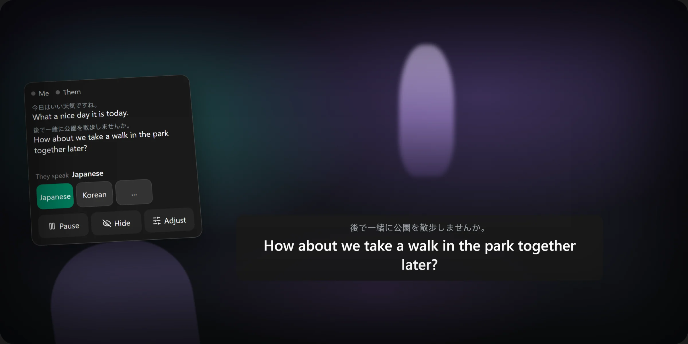

  

  <a href="README.md">简体中文</a> · <b>English</b> · <a href="README.ja.md">日本語</a> · <a href="README.ko.md">한국어</a>

  <a href="https://github.com/Rizumu85/kotomimi/releases/latest"><b>Download for desktop</b></a>
  · <a href="#android-app">Android app</a>
  · <a href="#three-steps">Three steps</a>
  · <a href="#with-vrchat">VRChat and VR</a>

  

## What it is

Kotomimi (ことみみ) is a live speech translation app: when you or the other side speak, the words and their translation appear on screen right away. It is a personal fork of [Sokuji](https://github.com/kizuna-ai-lab/sokuji), made for chatting with friends in another language while learning it, and it adds:

- **Captions you can read**: furigana over Japanese kanji, pinyin over Chinese, Jyutping over Cantonese, and an optional romanization line under Japanese, Korean and Russian.
- **A subtitle window**: the window becomes a single caption strip over your game, and clicks can pass through it to the game below.
- **Captions in a VR headset** (trial): what the other side says appears below your line of sight, and a wrist menu switches languages with a tap.
- **VRChat**: follows your VRChat mute, puts your translation in the chatbox above your head, and keeps world videos from slowing the translation.
- **Models where you want them**: speech recognition, translation and grammar feedback each run on this computer, another device on your network, an Android phone, or any API, in any mix. It works offline too.
- **Captions for the people around you**: anyone on the same Wi-Fi scans a code and reads the captions and translations on their own phone.
- **Typed translation**: press `Ctrl+K` during a session, type a sentence in your language, and get it in theirs.
- **Grammar feedback**: when you speak their language, it tells you whether the sentence was right and how to fix it.
- **A personal glossary**: write down your friends' names and the words it often mishears, and recognition and translation follow it.
- **Fonts and appearance**: separate fonts for the interface, Latin letters, and each language's text and readings; dark, light, or following the system.

Sokuji's own cloud providers (OpenAI, Gemini, Soniox and others) are all still there.

## Three steps

1. **Download and install.** From [Releases](https://github.com/Rizumu85/kotomimi/releases/latest):

   - **Windows**: `Kotomimi-x.y.z.Setup.exe`. The installer is not code-signed, so Windows warns about an unknown publisher: click "More info", then "Run anyway".
   - **macOS (Apple silicon)**: `Kotomimi-x.y.z-arm64.dmg`. It is not notarized by Apple: after dragging it into Applications, right-click the app and choose "Open" the first time.

2. **Follow the setup wizard.** Four steps: interface language, purpose, languages, done. Everything runs on this computer by default: afterwards the tour takes you to the "Model library" in the stage cards to download a recognition and a translation model, which switch on once downloaded. You can move any stage elsewhere in the settings later.

3. **Click "Start Session" and speak.**

No account and no API key are needed.

## Each stage on its own

A sentence goes through two stages on its way to a translation, speech recognition and translation; to practise speaking, you can add grammar feedback. Each stage has a card in the settings, and the model is chosen in the same card:

  

| Where | What it is | Good for |
|---|---|---|
| **Another device** | A Kotomimi sharing its models on your network, the Kotomimi Android app, or a model server such as LocalAI | A modest computer, or one running a game at the same time |
| **API model** | Any OpenAI-compatible API | Large cloud models |
| **This computer** | Models the app downloads and runs itself, fully offline if you like | Depending on no other device and no network |

## Two devices together

  

1. On **the computer that lends**: at the bottom of the "Provider" page in the settings, turn on "Share this computer's models" under "Share with other devices".
2. On **the other device**: click "Search my network for devices" under "Another device" and click the device it finds to connect; then choose "Another device" in the cards of the stages you want it to run.

Both need the same Wi-Fi or router, and the lending computer must have the app open. If Windows Firewall blocks it, the sharing card shows an "Allow" button. Languages and models are chosen on the device that uses them.

## Android app

Is your computer not fast enough, or running VRChat at the same time? Lend it an Android phone, and let the phone do the recognition, translation or grammar feedback.

  

1. Open the [latest release](https://github.com/Rizumu85/kotomimi/releases/latest), download `Kotomimi-phone-x.y.z.apk` from the Android line under "Installing", and install it on the phone (Android 9 or later; allow installing apps from unknown sources). You only install it this way once: it updates itself from then on.
2. Download models on the phone (Wi-Fi recommended), run the self-check to see whether this phone keeps up, then start sharing.
3. Search under "Another device" on the computer: the phone appears in the list, and one click connects it.

Which models a phone can run, and how to read the self-check, is in the [phone app's notes](android/README.md) (Chinese).

## With VRChat

When VRChat and Kotomimi run on the same Windows computer, the "General" settings have a "VRChat" card (turn on OSC in VRChat's quick menu):

- **Don't hear me while muted in VRChat**: mute yourself in VRChat, and Kotomimi stops recognizing what you say.
- **Above my avatar**: what you say (or type) goes into the chatbox above your head, translated, for the other players to read: the translation alone, or with what you said.
- **When a world plays a video**: its sound slows the other side's translation. Choose "Ask me", "People only", "People + video" or "Pause"; translating people takes the video's sound out where it can and hears only the players.
- **I speak ⟨their language⟩ too**: turned on under the translation languages, what you say in their language is translated into yours, so the chatbox reads for both sides.

### Captions in the headset (trial)

The "General" settings have a "VR headset" card: turn on **Show captions and the wrist menu in the headset** and choose the left or right wrist. Windows and SteamVR only; it works in any SteamVR game.

  

- **The caption strip**: the other side's latest sentence, the original small and the translation large, below your line of sight. It stays put when you turn your head a little and follows when you turn further; it clears when nothing new has been said for a while.
- **The wrist menu**: appears when you look at your wrist. Press it directly with the other controller: it uses no buttons, so it works beside tools such as XSOverlay. Its first page shows whether each side is heard, the last few lines, the other side's language, pause, and hiding the strip.
- **Adjust**: switch your own language, the recognition model and the translation model. Each model shows how far behind it actually ran this session, above the headset's frame rate and the graphics memory, so you can try models while you play and see which keeps up without slowing the game. A switch restarts the session by itself, and the strip says "Switching to…".

It is still a trial: feedback on where it sits and how it feels is welcome.

## And also

<b>Models on this computer</b>

 

Download them under "This computer" in each stage's card; the app installs the engine that runs them itself, with nothing else to install. The ⓘ next to each model gives its measured results.

- **Recognition**: the recommended **Qwen3-ASR 1.7B** (about 2.4 GB, 30 languages) writes as you speak, usually about a second behind the voice; it needs a graphics card and about 3 GB of its memory. Beside VRChat, use **SenseVoice-Small** for Chinese, Cantonese, English, Japanese or Korean (about 0.25 GB, only about 0.4 GB of graphics memory, the lightest and fastest), and **Qwen3-ASR 0.6B** for other languages (about 2 GB of graphics memory).
- **Translation**: **Index-Translate 2B** (about 1.3 GB, more than a hundred languages), about 0.1 seconds a sentence.
- **Grammar feedback**: **Gemma 4 E2B** (about 3 GB), with feedback almost at once.
- **On a Mac** (macOS 26 or later), the first recognizer is the system's own **Apple Speech**: the most accurate measured, and it takes no graphics memory.
- Models take graphics memory only during a session: they load when it starts and are released a minute after it ends. For no wait on the first start either, turn on "Start in the background when I sign in to Windows" under "Startup" in the settings.
- When you are not sure what language the other side will speak, set "Their language" to **Auto Detect** (needs Qwen3-ASR 1.7B or an API recognizer).

<b>Sharing captions with the people around you</b>

 

On the desktop app, click **Share captions** at the top right of the conversation, then turn sharing on: anyone on the same network scans the code with a phone, or types the address into a browser, and reads the captions and translations here, with nothing to install. "Open projector page" shows a large QR code, for putting on a screen at a meetup or an event.

<b>Speed test</b>

 

The "Test speed" button on the "Ready to start" line in the settings runs a reading of about ten seconds through every stage you have chosen, with no microphone, network delay included. A stage that cannot keep up with speech says so, and suggests a smaller model where there is one.

Test recordings: Japanese from LibriVox (public domain), the other languages from Google's FLEURS corpus (CC BY 4.0); see [THIRD_PARTY_NOTICES.md](THIRD_PARTY_NOTICES.md).

<b>Reading aids, glossary and fonts</b>

 

- **Furigana, pinyin, Jyutping and romanization** are switched in the display settings at the top right of the conversation. They are worked out on this computer, with no model and no network.
- **The personal glossary** is in the "General" settings: write down names and special words; for a word that was misheard, put what it was heard as under "Misheard as", and it is corrected from then on. You can also select a misheard word in the conversation and correct it there.
- **Fonts** are chosen under "Fonts" in the settings; a Latin font applies only to Latin letters and digits, never over Chinese or Japanese.

<b>Known limits</b>

 

- "Kotomimi Pipeline" gives text only, no synthesized speech. For spoken output, use one of Sokuji's own providers.
- Recognition through an API shows text only once a sentence is finished.
- The macOS build is for Apple silicon only.
- This is a personal fork: its pace and choices follow its author's own use.

## More detail

- [FORK.md](FORK.md): what the fork adds; the protocol between devices, building and releasing are in [docs/fork/](docs/fork/).
- Problems: [open an issue](https://github.com/Rizumu85/kotomimi/issues) here. Please don't trouble Sokuji's team: this fork's problems are not theirs.

## Credits and license

Kotomimi is built on [Sokuji](https://github.com/kizuna-ai-lab/sokuji) by [Kizuna AI Lab](https://github.com/kizuna-ai-lab), and most of its code is their work. This repository keeps the same license, [AGPL-3.0](LICENSE). The models' and dependencies' licenses are in [THIRD_PARTY_NOTICES.md](THIRD_PARTY_NOTICES.md).
