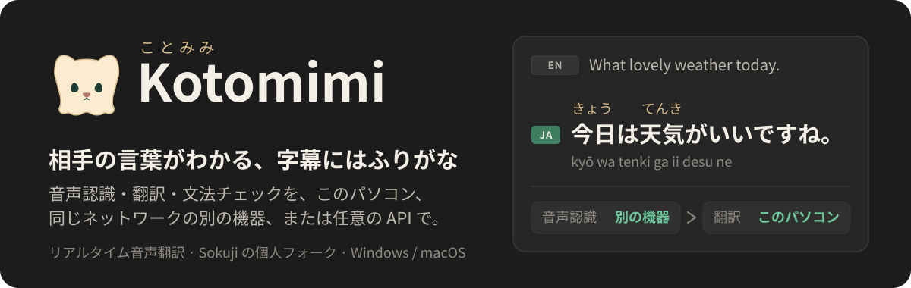
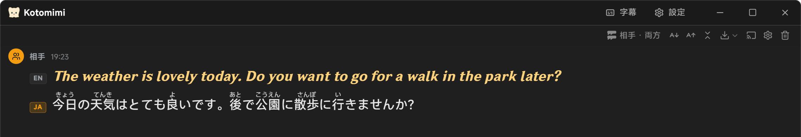
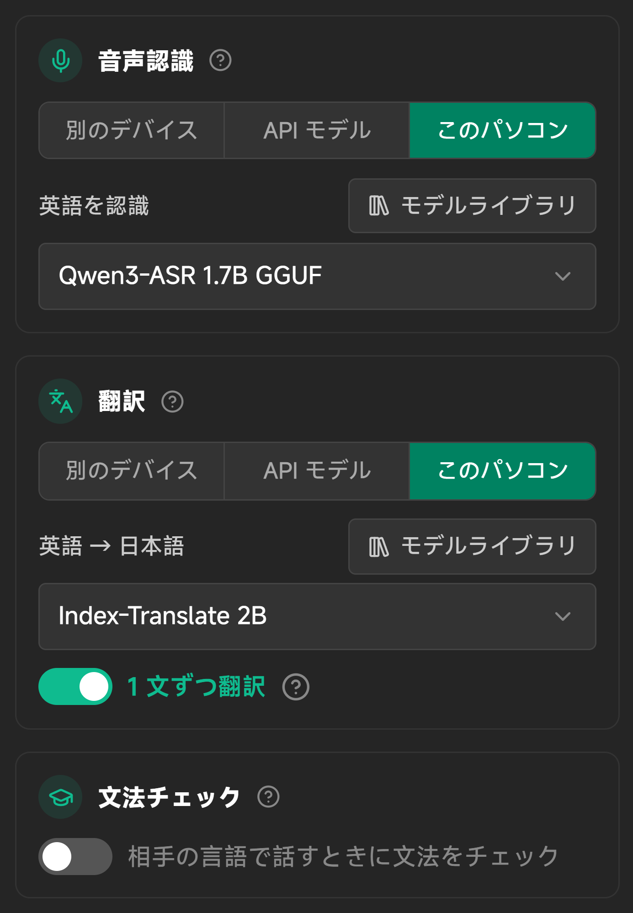
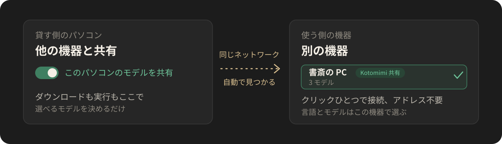
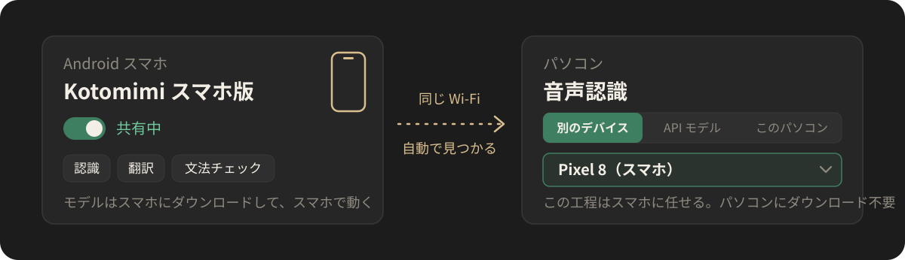
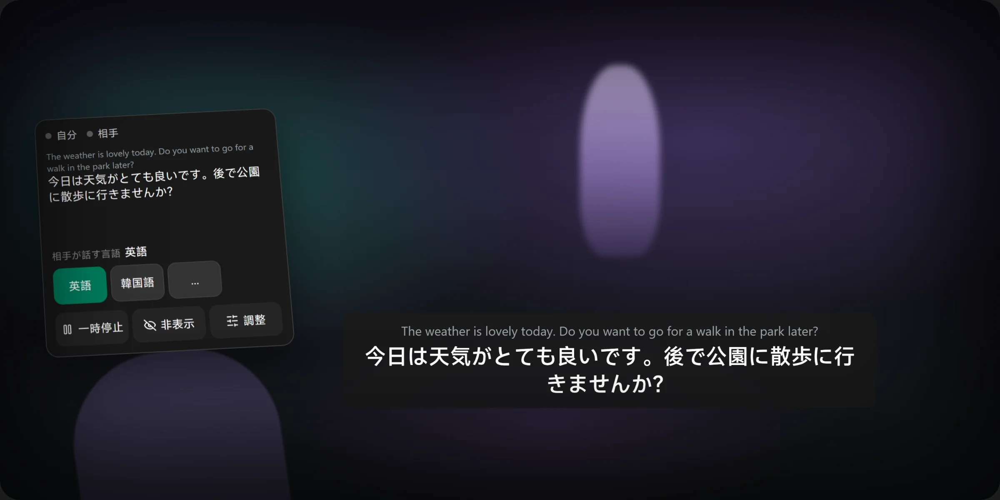

  

  <a href="README.md">简体中文</a> · <a href="README.en.md">English</a> · <b>日本語</b> · <a href="README.ko.md">한국어</a>

  <a href="https://github.com/Rizumu85/kotomimi/releases/latest"><b>パソコン版をダウンロード</b></a>
  · <a href="#android-アプリ">Android アプリ</a>
  · <a href="#3-ステップで始める">3 ステップで始める</a>
  · <a href="#vrchat-と一緒に使う">VRChat と VR</a>

  

## これは何？

Kotomimi（ことみみ）はリアルタイムの音声翻訳アプリです。自分や相手が話すと、話した言葉と訳がすぐ画面に出ます。[Sokuji](https://github.com/kizuna-ai-lab/sokuji) の個人フォークで、「外国語を話す友だちとおしゃべりしながら、ついでに言葉を覚える」ために、次の機能を足しています。

- **読める字幕**：日本語の漢字にふりがな、中国語にピンイン、広東語に粤拼（Jyutping）。日本語・韓国語・ロシア語の下にはローマ字表記も追加できます。
- **字幕ウィンドウ**：ウィンドウを 1 本の字幕バーにしてゲームの上に重ねられます。クリックは下のゲームに通せます。
- **VR ヘッドセットで字幕**（試用）：相手の言葉が視線の少し下に出ます。手首メニューをつつけば言語を切り替えられます。
- **VRChat と一緒に**：VRChat のミュートに合わせて止まり、自分の訳を頭上のチャットボックスに出し、ワールドの動画で翻訳が遅れないようにします。
- **モデルの置き場所は自由**：音声認識・翻訳・文法チェックを、それぞれこのパソコン、同じネットワークの別の機器、Android スマホ、任意の API で動かせます。組み合わせも自由で、オフラインでも使えます。
- **まわりの人に字幕を共有**：同じ Wi-Fi の人がコードを読み取るだけで、自分のスマホで字幕と訳を見られます。
- **入力でも翻訳**：セッション中に `Ctrl+K` を押して自分の言葉で打てば、相手の言葉に訳します。
- **文法チェック**：相手の言語で話したとき、合っているか、どう直せばいいかを教えてくれます。
- **ユーザー辞書**：友だちの名前や、よく誤認識される言葉を書いておくと、認識と翻訳がそれに従います。
- **フォントと外観**：画面、ラテン文字、言語ごとの本文とふりがなのフォントを別々に選べます。外観はダーク・ライト・システム設定に合わせる、から選べます。

Sokuji 由来のクラウドのプロバイダー（OpenAI、Gemini、Soniox など）もそのまま使えます。

## 3 ステップで始める

1. **ダウンロードしてインストールします。** [Releases](https://github.com/Rizumu85/kotomimi/releases/latest) から：

   - **Windows**：`Kotomimi-x.y.z.Setup.exe`。コード署名がないので「不明な発行元」と出ます。「詳細情報」→「実行」を押してください。
   - **macOS（Apple シリコン）**：`Kotomimi-x.y.z-arm64.dmg`。Apple の公証を受けていないので、「アプリケーション」に入れたあと、最初の 1 回だけアプリを右クリックして「開く」を選んでください。

2. **セットアップの案内に従います。** 画面の言語、用途、言語、完了の 4 ステップです。最初はすべてこのパソコンで動きます。終わるとガイドが、各カードの「モデルライブラリ」で認識と翻訳のモデルをダウンロードするところへ案内します。ダウンロードが終われば自動で使われます。あとから設定でいつでも置き場所を変えられます。

3. **「セッション開始」を押して話します。**

アカウント登録も API キーもいりません。

## 工程ごとに選べる

話した言葉が訳になるまでに、音声認識と翻訳の 2 つの工程を通ります。話す練習をしたいときは文法チェックも足せます。設定には工程ごとにカードがあり、使うモデルも同じカードで選びます。

  

| 置き場所 | どんなもの | 向いているとき |
|---|---|---|
| **別のデバイス** | 同じネットワークでモデルを共有している Kotomimi、Kotomimi の Android アプリ、LocalAI などのモデルサーバー | このパソコンの性能がいまひとつ、またはゲームを同時に動かしたい |
| **API モデル** | OpenAI 互換の API ならどれでも | クラウドの大きなモデルを使いたい |
| **このパソコン** | アプリが自分でダウンロードして動かすモデル。完全オフラインも可 | ほかの機器やネットに頼りたくない |

## 2 台の機器で使う

  

1. **貸す側のパソコン**で：設定の「プロバイダー」ページの一番下、「ほかのデバイスと共有」の中の「このパソコンのモデルを共有」をオンにします。
2. **使う側の機器**で：「別のデバイス」の欄の「ローカルネットワークのデバイスを検索」を押し、見つかった機器をクリックするとつながります。そのあと、任せたい工程のカードで「別のデバイス」を選びます。

2 台は同じ Wi-Fi かルーターにつないで、貸す側ではアプリを開いたままにしておきます。Windows ファイアウォールに止められたときは、共有のカードに「許可」ボタンが出ます。言語や使うモデルは、使う側の機器で選びます。

## Android アプリ

パソコンが速くない、または VRChat を同時に動かしたい？ Android スマホをパソコンに貸して、認識・翻訳・文法チェックをスマホにやってもらえます。

  

1. [最新のリリース](https://github.com/Rizumu85/kotomimi/releases/latest)を開き、「安装 / Installing」の Android アプリの行にあるリンクから `Kotomimi-phone-x.y.z.apk` をダウンロードしてスマホに入れます（Android 9 以上。「提供元不明のアプリのインストール」を許可してください）。この方法で入れるのは 1 回だけで、以降はアプリが自動で更新されます。
2. スマホでモデルをダウンロードし、セルフチェックでこのスマホが追いつけるかを確かめてから、共有を始めます。
3. パソコンの「別のデバイス」の欄で検索すると、スマホが一覧に出ます。クリックすればつながります。

スマホで動くモデルやセルフチェックの読み方は、[スマホ版の説明](android/README.md)（中国語）にあります。

## VRChat と一緒に使う

VRChat と Kotomimi が同じ Windows パソコンで動いているとき、設定の「一般」に「VRChat」のカードが出ます（VRChat のクイックメニューで OSC をオンにしてください）。

- **VRChat でミュート中は自分の音声を認識しない**：VRChat でミュートすると、Kotomimi も自分の声を認識しません。
- **頭上に表示**：自分が話した（または打った）言葉を訳して、頭上のチャットボックスに出します。ほかのプレイヤーにも見えます。訳だけか、元の文と訳の両方かを選べます。
- **ワールドで動画が再生されたとき**：動画の音で相手の翻訳が遅れます。「毎回確認」「会話のみ翻訳」「会話と動画を翻訳」「翻訳を一時停止」から選べます。会話を翻訳するときは、できるだけ動画の音を取り除いてプレイヤーの声だけを聞きます。
- **〇〇語でも話す**：翻訳言語の下でオンにすると、自分が相手の言語で話したときに自分の言語へ訳し、チャットボックスを双方が読めるようになります。

### ヘッドセットで字幕を見る（試用）

設定の「一般」の「VRヘッドセット」カードで **ヘッドセット内に字幕と手首メニューを表示** をオンにし、左右どちらの手首か選びます。Windows と SteamVR のみ対応です。

  

- **字幕バー**：相手が言ったばかりの文。元の文は小さく、訳は大きく、視線の少し下に出ます。少し頭を動かしても動かず、大きく向きを変えるとついてきます。しばらく新しい文がないと消えます。
- **手首メニュー**：手首を見ると出てきます。もう片方の手のコントローラーで直接つつきます。ボタンを使わないので、XSOverlay などのツールと一緒に使えます。最初のページには、自分と相手の音声を示す丸い印、最近の数行、相手の言語、一時停止、字幕バーを隠すボタンがあります。
- **調整**：自分の言語、認識モデル、翻訳モデルを切り替えます。各モデルの横には、このセッションで実際にどれくらい遅れたかが出て、一番下には VR のフレームレートとビデオメモリが出ます。遊びながら切り替えて、遅れずゲームも重くしないモデルを見つけられます。切り替えるとセッションは自動でやり直され、字幕バーに「切り替え中」と出ます。

まだ試用版です。使い心地の感想をお待ちします。

## そのほか

<b>このパソコンで動くモデル</b>

 

各工程のカードの「このパソコン」からダウンロードします。動かすためのエンジンもアプリが自分で入れるので、ほかに何も入れる必要はありません。各モデルの横の ⓘ に実測の結果があります。

- **認識**：おすすめの **Qwen3-ASR 1.7B**（約 2.4 GB、30 言語）は話しながら文字が出て、ふつうは声より 1 秒ほど遅れるだけです。グラフィックボードが必要で、ビデオメモリを約 3 GB 使います。VRChat と一緒なら、中国語・広東語・英語・日本語・韓国語には **SenseVoice-Small**（約 0.25 GB、ビデオメモリ約 0.4 GB、いちばん軽くて速い）、ほかの言語には **Qwen3-ASR 0.6B**（ビデオメモリ約 2 GB）を使ってください。
- **翻訳**：**Index-Translate 2B**（約 1.3 GB、100 以上の言語）。1 文 0.1 秒ほどです。
- **文法チェック**：**Gemma 4 E2B**（約 3 GB）。ほぼすぐに返ってきます。
- **Mac**（macOS 26 以降）では、最初にシステムの **Apple Speech** が出ます。実測でいちばん正確で、ビデオメモリも使いません。
- モデルがビデオメモリを使うのはセッション中だけです。開始時に読み込み、終了の 1 分後に解放します。最初の開始も待ちたくないときは、設定の「起動」で「Windows へのサインイン時にバックグラウンドで起動」をオンにします。
- 相手が何語を話すかわからないときは、「相手の言語」を **自動検出** にします（Qwen3-ASR 1.7B か API の認識モデルが必要です）。

<b>まわりの人に字幕を共有する</b>

 

パソコン版で会話の右上の **字幕を共有** を押し、「字幕を共有する」を押します。同じネットワークの人がスマホでコードを読み取るか、パソコンのブラウザにアドレスを入れれば、ここの字幕と訳を見られます。何もインストールする必要はありません。「投影ページを開く」は大きな QR コードを出すので、集まりやイベントでスクリーンに映すのに向いています。

<b>速度をテスト</b>

 

設定の「準備完了」の行にある「速度をテスト」ボタンで、約 10 秒の朗読録音を、選んだすべての工程に通します。マイクは使わず、ネットワークの遅れも含めて測ります。話す速さに追いつけない工程があれば知らせ、替えられるときは小さいモデルをすすめます。

テスト用の録音：日本語は LibriVox（パブリックドメイン）、ほかの言語は Google の FLEURS コーパス（CC BY 4.0）です。詳しくは [THIRD_PARTY_NOTICES.md](THIRD_PARTY_NOTICES.md)。

<b>読みの補助、ユーザー辞書、フォント</b>

 

- **ふりがな・ピンイン・粤拼・ローマ字**は、会話の右上の「表示設定」で切り替えます。このパソコンの中で求めていて、モデルもネットも使いません。
- **ユーザー辞書**は設定の「一般」にあります。名前や専門用語を書いておき、聞き間違えられた言葉は「誤認識された表記」に実際に出た書き方を入力しておくと、次から自動で直ります。会話の中で聞き間違えた言葉を選んで、その場で直すこともできます。
- **フォント**は設定の「フォント」で選びます。ラテン文字のフォントはラテン文字と数字にだけ使われ、中国語や日本語のフォントを上書きしません。

<b>わかっている制限</b>

 

- 「Kotomimi 自由に組み合わせ」は文字だけで、音声は合成しません。音声で出したいときは Sokuji にもとからあるプロバイダーを使ってください。
- API で認識するときは、文が終わってから文字が出ます。
- macOS 版は Apple シリコン向けだけです。
- 個人のフォークなので、更新や機能の取捨は作者の都合で決まります。

## もっと詳しく

- [FORK.md](FORK.md)：このフォークで足したもの。機器どうしの決まりごと、ビルドとリリースは [docs/fork/](docs/fork/) にあります（英語）。
- 困ったときは：[issue を立ててください](https://github.com/Rizumu85/kotomimi/issues)。Sokuji の公式には問い合わせないでください。このフォークの問題は Sokuji 開発チームの担当外です。

## クレジットとライセンス

Kotomimi は [Kizuna AI Lab](https://github.com/kizuna-ai-lab) の [Sokuji](https://github.com/kizuna-ai-lab/sokuji) の上に作られていて、コードの大部分は彼らの仕事です。このリポジトリも同じライセンス [AGPL-3.0](LICENSE) です。モデルと依存ライブラリのライセンスは [THIRD_PARTY_NOTICES.md](THIRD_PARTY_NOTICES.md) にあります。
