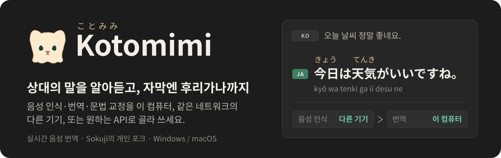
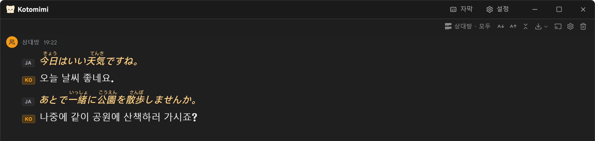
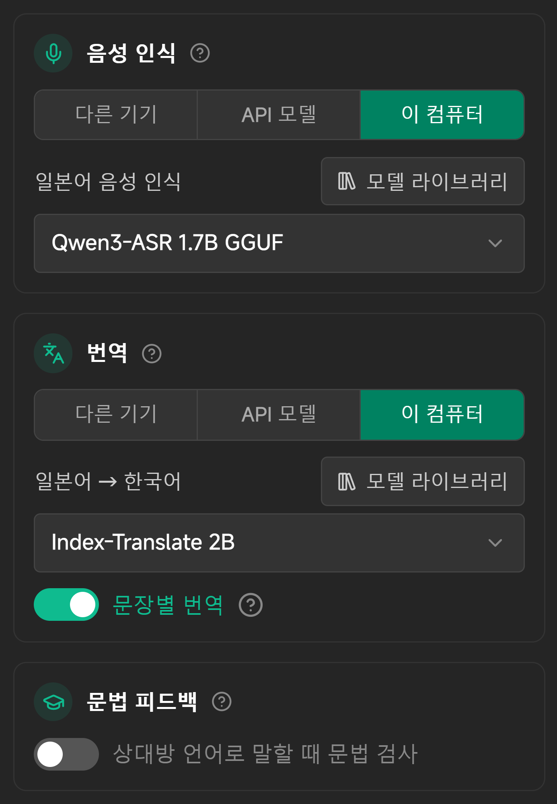
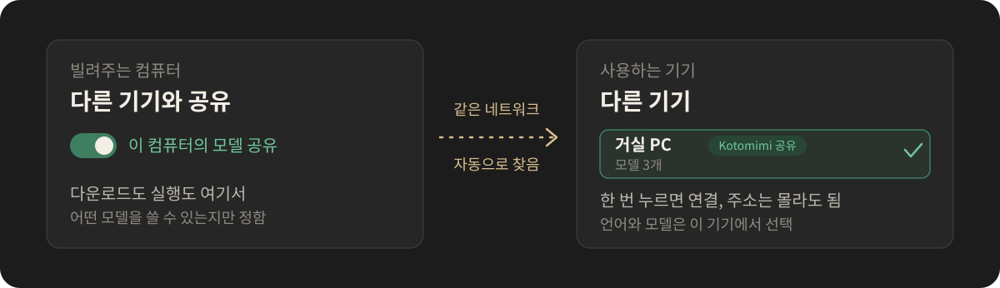
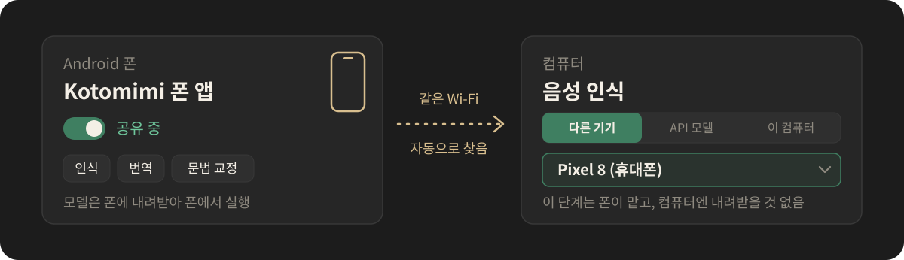
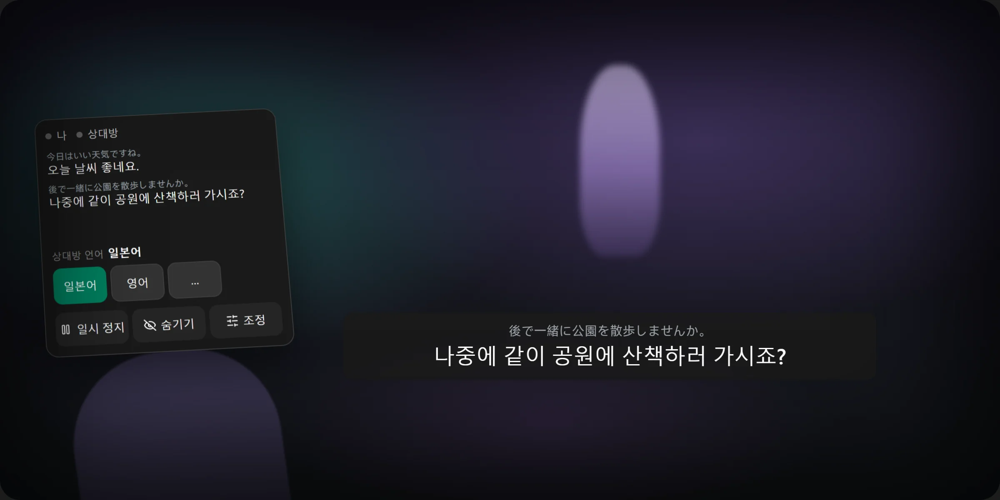

  

  <a href="README.md">简体中文</a> · <a href="README.en.md">English</a> · <a href="README.ja.md">日本語</a> · <b>한국어</b>

  <a href="https://github.com/Rizumu85/kotomimi/releases/latest"><b>PC 버전 다운로드</b></a>
  · <a href="#android-앱">Android 앱</a>
  · <a href="#세-단계로-시작하기">세 단계로 시작하기</a>
  · <a href="#vrchat과-함께-쓰기">VRChat과 VR</a>

  

## 이게 뭔가요?

Kotomimi(ことみみ)는 실시간 음성 번역 앱입니다. 나나 상대가 말하면 원문과 번역이 바로 화면에 나옵니다. [Sokuji](https://github.com/kizuna-ai-lab/sokuji)의 개인 포크로, "외국어를 쓰는 친구와 이야기하면서 그 언어도 배우기"를 위해 다음 기능을 더했습니다.

- **읽을 수 있는 자막**: 일본어 한자 위에 후리가나, 중국어에 병음, 광둥어에 윗핑(Jyutping)을 달고, 일본어·한국어·러시아어 아래에 로마자 줄을 더할 수 있습니다.
- **자막 창**: 창을 자막 한 줄로 바꿔 게임 위에 띄울 수 있고, 클릭은 아래 게임으로 넘길 수 있습니다.
- **VR 헤드셋에서 자막**(체험판): 상대의 말이 시선 조금 아래에 나오고, 손목 메뉴를 누르면 언어를 바꿀 수 있습니다.
- **VRChat과 함께**: VRChat 음소거 상태에 맞춰 인식을 멈추고, 내 번역을 머리 위 채팅 상자에 띄우며, 월드의 동영상 때문에 번역이 늦어지지 않게 합니다.
- **모델은 원하는 곳에서**: 음성 인식·번역·문법 교정을 각각 이 컴퓨터, 같은 네트워크의 다른 기기, Android 폰, 또는 원하는 API에서 돌릴 수 있고, 자유롭게 섞을 수 있습니다. 오프라인에서도 됩니다.
- **주변 사람에게 자막 공유**: 같은 Wi-Fi에 있는 사람이 코드를 스캔하면 자기 폰에서 자막과 번역을 볼 수 있습니다.
- **입력으로도 번역**: 세션 중에 `Ctrl+K`를 누르고 내 언어로 입력하면 상대 언어로 번역됩니다.
- **문법 교정**: 내가 상대의 언어로 말하면 맞게 말했는지, 어떻게 고치면 되는지 알려 줍니다.
- **개인 사전**: 친구 이름이나 자주 잘못 알아듣는 말을 적어 두면 음성 인식과 번역에 반영됩니다.
- **글꼴과 모양**: 화면, 라틴 문자, 언어별 본문과 읽기 표시의 글꼴을 따로 고를 수 있고, 어둡게·밝게·시스템 설정 따르기 중에서 고를 수 있습니다.

Sokuji에 원래 있던 클라우드 제공자(OpenAI, Gemini, Soniox 등)도 그대로 있습니다.

## 세 단계로 시작하기

1. **다운로드하고 설치합니다.** [Releases](https://github.com/Rizumu85/kotomimi/releases/latest)에서:

   - **Windows**: `Kotomimi-x.y.z.Setup.exe`. 코드 서명이 없어서 Windows가 "알 수 없는 게시자"라고 경고합니다. "추가 정보"를 누른 뒤 "실행"을 누르세요.
   - **macOS(Apple 실리콘)**: `Kotomimi-x.y.z-arm64.dmg`. Apple 공증을 받지 않았으므로, "응용 프로그램"으로 옮긴 뒤 처음 한 번은 앱을 오른쪽 클릭하고 "열기"를 고르세요.

2. **설정 마법사를 따라갑니다.** 화면 언어, 용도, 언어, 완료의 네 단계입니다. 처음에는 모든 것이 이 컴퓨터에서 돌아갑니다. 마법사가 끝나면 안내가 각 카드의 "모델 라이브러리"에서 인식 모델과 번역 모델을 내려받도록 도와주고, 다 받으면 자동으로 켜집니다. 나중에 설정에서 언제든 위치를 바꿀 수 있습니다.

3. **"세션 시작"을 누르고 말하세요.**

계정 가입도 API 키도 필요 없습니다.

## 단계마다 따로 고르기

말한 내용이 번역이 되기까지 음성 인식과 번역 두 단계를 거칩니다. 말하기 연습을 하고 싶다면 문법 교정도 켤 수 있습니다. 설정에는 단계마다 카드가 있고, 쓸 모델도 같은 카드에서 고릅니다.

  

| 위치 | 무엇인가 | 이럴 때 |
|---|---|---|
| **다른 기기** | 같은 네트워크에서 모델을 공유하는 Kotomimi, Kotomimi Android 앱, 또는 LocalAI 같은 모델 서버 | 이 컴퓨터 사양이 아쉽거나, 게임을 같이 돌릴 때 |
| **API 모델** | OpenAI 호환 API라면 무엇이든 | 클라우드의 큰 모델을 쓰고 싶을 때 |
| **이 컴퓨터** | 앱이 직접 내려받아 돌리는 모델. 완전 오프라인도 가능 | 다른 기기나 네트워크에 기대고 싶지 않을 때 |

## 두 기기로 함께 쓰기

  

1. **빌려주는 컴퓨터**에서: 설정의 "제공자" 페이지 맨 아래, "다른 기기에 공유" 안의 "이 컴퓨터의 모델 공유"를 켭니다.
2. **사용하는 기기**에서: "다른 기기" 칸의 "로컬 네트워크에서 기기 찾기"를 누르고, 찾은 기기를 누르면 연결됩니다. 그다음 맡기고 싶은 단계의 카드에서 "다른 기기"를 고릅니다.

두 기기는 같은 Wi-Fi나 공유기에 연결되어 있어야 하고, 빌려주는 컴퓨터는 앱을 켜 두어야 합니다. Windows 방화벽이 막으면 공유 카드에 "허용" 버튼이 나옵니다. 언어와 쓸 모델은 사용하는 기기에서 고릅니다.

## Android 앱

컴퓨터가 충분히 빠르지 않거나 VRChat을 같이 돌리나요? Android 폰을 컴퓨터에 빌려주고, 인식·번역·문법 교정을 폰이 맡게 할 수 있습니다.

  

1. [최신 릴리스](https://github.com/Rizumu85/kotomimi/releases/latest)를 열고 "安装 / Installing"의 Android 앱 줄에 있는 링크에서 `Kotomimi-phone-x.y.z.apk`를 받아 폰에 설치합니다(Android 9 이상, "출처를 알 수 없는 앱 설치"를 허용해야 합니다). 이렇게 설치하는 건 한 번뿐이고, 그다음부터는 스스로 업데이트합니다.
2. 폰에서 모델을 내려받고(Wi-Fi 권장), 자가 점검으로 이 폰이 따라갈 수 있는지 확인한 뒤 공유를 시작합니다.
3. 컴퓨터의 "다른 기기" 칸에서 찾으면 폰이 목록에 나오고, 누르면 연결됩니다.

폰에서 돌릴 수 있는 모델과 자가 점검 결과 보는 법은 [폰 앱 설명](android/README.md)(중국어)에 있습니다.

## VRChat과 함께 쓰기

VRChat과 Kotomimi가 같은 Windows 컴퓨터에서 돌아가면, 설정의 "일반"에 "VRChat" 카드가 나옵니다(VRChat 퀵 메뉴에서 OSC를 켜세요).

- **VRChat에서 마이크를 끄면 내 음성 인식 중지**: VRChat에서 음소거하면 Kotomimi도 내 말을 인식하지 않습니다.
- **머리 위에 표시**: 내가 말한(또는 입력한) 내용을 번역해 머리 위 채팅 상자에 띄웁니다. 다른 플레이어도 볼 수 있습니다. 번역만 띄울지, 원문과 번역을 같이 띄울지 고를 수 있습니다.
- **월드에서 동영상 재생 시**: 동영상 소리 때문에 상대의 번역이 늦어집니다. "매번 묻기", "사람 목소리만 번역", "목소리와 동영상 모두 번역", "번역 일시 중지" 중에서 고를 수 있습니다. 사람 목소리를 번역할 때는 가능한 한 동영상 소리를 빼고 플레이어 목소리만 듣습니다.
- **〇〇 언어로도 말하기**: 번역 언어 아래에서 켜면, 내가 상대의 언어로 말했을 때 내 언어로 번역되어 양쪽 모두 채팅 내용을 이해할 수 있습니다.

### 헤드셋에서 자막 보기(체험판)

설정의 "일반"에 있는 "VR 헤드셋" 카드에서 **헤드셋에 자막과 손목 메뉴 표시**를 켜고, 손목 메뉴를 왼손과 오른손 중 어디에 둘지 고릅니다. Windows와 SteamVR에서만 되며, 어떤 SteamVR 게임에서도 쓸 수 있습니다.

  

- **자막 바**: 상대가 방금 한 말. 원문은 작게, 번역은 크게, 시선 조금 아래에 나옵니다. 고개를 조금 돌려도 움직이지 않고, 많이 돌리면 따라옵니다. 한동안 새 말이 없으면 사라집니다.
- **손목 메뉴**: 손목을 보면 나타납니다. 다른 손의 컨트롤러로 직접 누르며, 버튼을 쓰지 않으므로 XSOverlay 같은 도구와 함께 쓸 수 있습니다. 첫 화면에는 양쪽 소리 표시 점, 최근 몇 줄, 상대의 언어, 일시 중지, 자막 바 숨기기가 있습니다.
- **조정**: 내 언어, 인식 모델, 번역 모델을 바꿉니다. 모델마다 이번 세션에서 실제로 얼마나 늦었는지가 나오고, 맨 아래에는 VR 프레임 레이트와 그래픽 메모리가 나옵니다. 게임하면서 바꿔 보고 늦지 않으면서 게임도 느려지지 않는 모델을 찾을 수 있습니다. 바꾸면 세션이 알아서 다시 시작되고, 자막 바에 "전환 중"이라고 나옵니다.

아직 체험판입니다. 위치나 쓰는 느낌에 대한 의견을 기다립니다.

## 그 밖에

<b>이 컴퓨터에서 돌아가는 모델</b>

 

각 단계 카드의 "이 컴퓨터"에서 내려받습니다. 돌리는 엔진도 앱이 알아서 설치하므로 따로 설치할 것은 없습니다. 모델 옆의 ⓘ에 실측 결과가 있습니다.

- **인식**: 추천 모델 **Qwen3-ASR 1.7B**(약 2.4 GB, 30개 언어)는 말하는 동안 글자가 나오고, 보통 목소리보다 1초쯤 늦을 뿐입니다. 그래픽 카드가 필요하고 그래픽 메모리를 약 3 GB 씁니다. VRChat과 같이 쓸 때는 중국어·광둥어·영어·일본어·한국어라면 **SenseVoice-Small**(약 0.25 GB, 그래픽 메모리 약 0.4 GB, 가장 가볍고 빠름), 그 밖의 언어라면 **Qwen3-ASR 0.6B**(그래픽 메모리 약 2 GB)를 사용합니다.
- **번역**: **Index-Translate 2B**(약 1.3 GB, 100개 이상 언어), 한 문장에 0.1초쯤입니다.
- **문법 교정**: **Gemma 4 E2B**(약 3 GB), 거의 바로 답합니다.
- **Mac**(macOS 26 이상)에서는 맨 위에 시스템의 **Apple Speech**가 나옵니다. 실측으로 가장 정확하고, 그래픽 메모리를 쓰지 않습니다.
- 모델은 세션 중에만 그래픽 메모리를 씁니다. 시작할 때 불러오고 세션 종료 1분 후에 메모리에서 해제합니다. 첫 시작도 기다리기 싫다면 설정의 "자동 시작"에서 "Windows 로그인 시 백그라운드에서 시작"을 켜세요.
- 상대가 어떤 언어로 말할지 모를 때는 "상대방 언어"를 **자동 감지**로 고릅니다(Qwen3-ASR 1.7B나 API 인식 모델이 필요합니다).

<b>주변 사람에게 자막 공유하기</b>

 

PC 버전에서 대화 오른쪽 위의 **자막 공유**를 누르고 공유를 켜세요. 같은 네트워크의 사람이 폰으로 코드를 스캔하거나 컴퓨터 브라우저에 주소를 넣으면 여기의 자막과 번역을 볼 수 있고, 아무것도 설치할 필요가 없습니다. "프로젝터 화면 열기"는 큰 QR 코드를 띄우므로 모임이나 행사에서 화면에 띄우기 좋습니다.

<b>속도 테스트</b>

 

설정의 "시작할 준비가 됐습니다" 줄에 있는 "속도 테스트" 버튼은 약 10초짜리 낭독 녹음을 선택한 모든 단계에 넣어 측정합니다. 마이크는 쓰지 않고, 네트워크 지연도 포함됩니다. 말하는 속도를 따라가지 못하는 단계가 있으면 알려 주고, 바꿀 수 있으면 더 작은 모델을 권합니다.

테스트 녹음: 일본어는 LibriVox(퍼블릭 도메인), 나머지 언어는 Google의 FLEURS 말뭉치(CC BY 4.0)에서 가져왔습니다. 자세한 내용은 [THIRD_PARTY_NOTICES.md](THIRD_PARTY_NOTICES.md)에 있습니다.

<b>읽기 보조, 개인 사전, 글꼴</b>

 

- **후리가나·병음·윗핑·로마자**는 대화 오른쪽 위의 "표시 설정"에서 켜고 끕니다. 이 컴퓨터 안에서 계산하며, 모델도 네트워크도 쓰지 않습니다.
- **개인 사전**은 설정의 "일반"에 있습니다. 이름과 전문 용어를 적어 두고, 잘못 알아들은 말은 "잘못 인식된 말"에 잘못 인식된 내용을 입력해 두면 다음부터 자동으로 고쳐집니다. 대화 안에서 잘못 알아들은 말을 골라 바로 고칠 수도 있습니다.
- **글꼴**은 설정의 "글꼴"에서 고릅니다. 라틴 글꼴은 라틴 문자와 숫자에만 쓰이고 중국어나 일본어 글꼴을 덮어쓰지 않습니다.

<b>알려진 제한</b>

 

- "Kotomimi 자유 조합"은 글자만 내고 음성은 합성하지 않습니다. 음성 출력이 필요하면 Sokuji에 원래 있던 제공자를 쓰세요.
- API로 인식할 때는 문장이 끝나야 글자가 나옵니다.
- macOS 버전은 Apple 실리콘용만 있습니다.
- 개인 포크이므로 업데이트 속도와 기능 선택은 만든 사람이 직접 쓰는 사정에 따릅니다.

## 더 자세히

- [FORK.md](FORK.md): 이 포크에서 더한 것. 기기 간 통신 규약, 빌드와 릴리스는 [docs/fork/](docs/fork/)에 있습니다(영어).
- 문제가 생기면: [이슈를 올려 주세요](https://github.com/Rizumu85/kotomimi/issues). Sokuji 공식 쪽에는 문의하지 말아 주세요. 이 포크의 문제는 Sokuji 개발팀의 담당이 아닙니다.

## 크레딧과 라이선스

Kotomimi는 [Kizuna AI Lab](https://github.com/kizuna-ai-lab)의 [Sokuji](https://github.com/kizuna-ai-lab/sokuji) 위에 만들어졌고, 코드 대부분은 그들의 작업입니다. 이 저장소도 같은 라이선스 [AGPL-3.0](LICENSE)을 따릅니다. 모델과 의존 라이브러리의 라이선스는 [THIRD_PARTY_NOTICES.md](THIRD_PARTY_NOTICES.md)에 있습니다.
