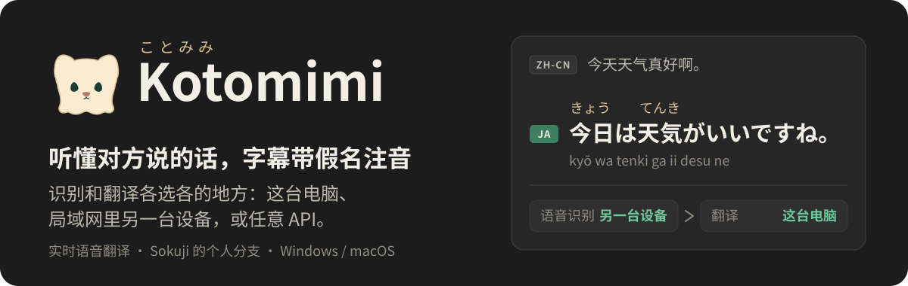
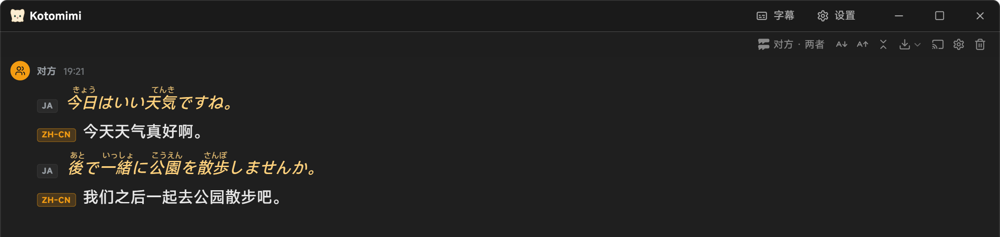
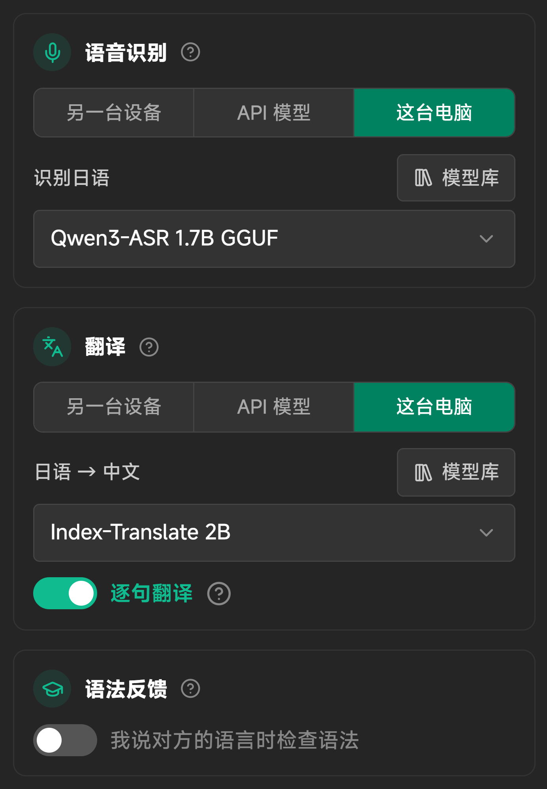
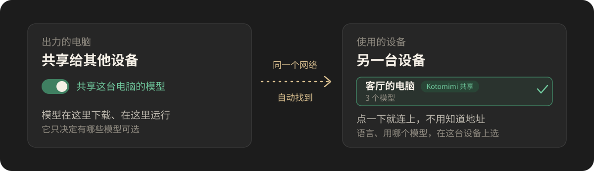
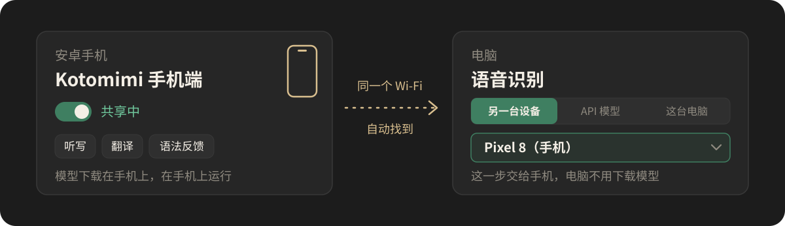
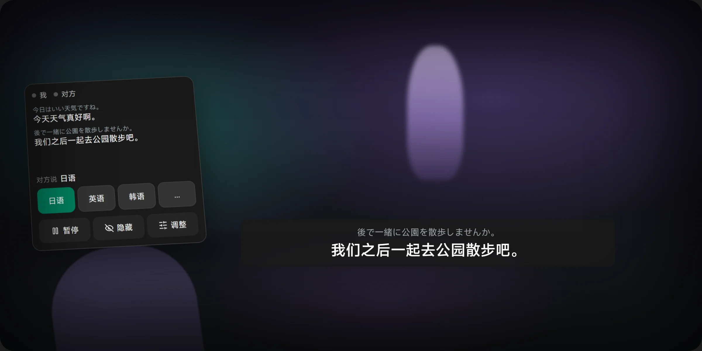

  

  <b>简体中文</b> · <a href="README.en.md">English</a> · <a href="README.ja.md">日本語</a> · <a href="README.ko.md">한국어</a>

  <a href="https://github.com/Rizumu85/kotomimi/releases/latest"><b>下载电脑版</b></a>
  · <a href="#安卓手机端">安卓手机端</a>
  · <a href="#三步上手">三步上手</a>
  · <a href="#和-vrchat-一起用">VRChat 和 VR</a>

  

## 这是什么

Kotomimi（ことみみ）是一个实时语音翻译应用：你或对方开口说话，屏幕上马上出现原文和译文。它是 [Sokuji](https://github.com/kizuna-ai-lab/sokuji) 的个人分支，为"跟说外语的朋友聊天、顺便学语言"加了这些：

- **读得懂的字幕**：日语汉字上方标假名，中文标拼音，粤语标粤拼；日语、韩语、俄语下面可以加一行罗马音。
- **字幕窗口**：窗口变成一条字幕，可以盖在游戏上，鼠标还能点到下面的游戏。
- **在 VR 头显里看字幕**（试用）：对方说的话显示在视线下方，手腕上有个小面板，戳一下就能换语言。
- **和 VRChat 一起用**：跟着 VRChat 的静音，把你的译文显示在头顶聊天框，世界里放视频时不拖慢翻译。
- **模型放在哪由你定**：语音识别、翻译、语法反馈各自可以在这台电脑、局域网里另一台设备、安卓手机或任意 API 上运行，随便混搭。不联网也能用。
- **把字幕分享给身边的人**：同一个 Wi-Fi 下的人扫码，就能在自己的手机上看字幕和译文。
- **打字也能翻**：会话中按 `Ctrl+K`，打一句母语，得到对方语言的译文。
- **语法反馈**：自己说对方的语言时，告诉你这句说得对不对、该怎么改。
- **个性化词典**：写下朋友的名字和常被听错的词，识别和翻译会照着改。
- **字体和外观**：界面、拉丁字母、每种语言的正文和注音分别选字体；深色、浅色或跟随系统。

Sokuji 原有的云服务提供商（OpenAI、Gemini、Soniox 等）都还在。

## 三步上手

1. **下载安装。** 到 [Releases](https://github.com/Rizumu85/kotomimi/releases/latest) 下载：

   - **Windows**：`Kotomimi-x.y.z.Setup.exe`。安装包没有代码签名，Windows 会提示"未知发布者"：点"更多信息"，再点"仍要运行"。
   - **macOS（Apple 芯片）**：`Kotomimi-x.y.z-arm64.dmg`。没有经过 Apple 公证：拖进"应用程序"后，第一次要右键点应用，选"打开"。

2. **跟着向导走。** 四步：界面语言、用途、语言、完成。一切默认在这台电脑上运行：结束后引导会带你在环节卡片的"模型库"里下载听写和翻译模型，下完自动启用。之后想换个去处，随时在设置里改。

3. **点"开始会话"，开口说话。**

不需要注册账号，也不需要 API 密钥。

## 每个环节各选各的

一句话从说出口到变成译文，要过语音识别和翻译两个环节；想练口语时，还可以打开语法反馈。设置里每个环节一张卡片，用哪个模型也在卡片里选：

  

| 去处 | 是什么 | 适合 |
|---|---|---|
| **另一台设备** | 局域网里开了共享的 Kotomimi、Kotomimi 手机端，或 LocalAI 这类模型服务器 | 这台电脑配置一般，或要同时开游戏 |
| **API 模型** | 任何 OpenAI 兼容的接口 | 想用云端的大模型 |
| **这台电脑** | 应用自己下载、自己运行的模型，可以完全离线 | 不想依赖别的设备和网络 |

## 两台设备一起用

  

1. 在**出力的电脑**上：在设置的"提供商"页最下面，打开"共享给其他设备"里的"共享这台电脑的模型"。
2. 在**另一台设备**上：在"另一台设备"一栏点搜索，点一下找到的设备就连上；再在想交给它的环节卡片里选"另一台设备"。

两台设备要连同一个 Wi-Fi 或路由器，出力的那台要开着应用。Windows 防火墙挡住时，共享卡片里会出现"允许"按钮。语言和用哪个模型，在使用的那台设备上选。

## 安卓手机端

电脑不够快，或者要同时开 VRChat？把一台安卓手机借给电脑，让手机来听写、翻译或给语法反馈。

  

1. 打开[最新的发布页](https://github.com/Rizumu85/kotomimi/releases/latest)，在"安装"一节"安卓手机端"那一行点链接，下载 `Kotomimi-phone-x.y.z.apk` 装到手机上（Android 9 及以上，要允许"安装未知来源的应用"）。只用这样装一次，以后它会自己更新。
2. 在手机上下载模型（建议连 Wi-Fi），点"自检"看这台手机跟不跟得上，再点"开始共享"。
3. 在电脑的"另一台设备"一栏搜索，手机会出现在列表里，点一下就连上。

手机能跑的模型、怎么看自检结果，见 [手机端说明](android/README.md)。

## 和 VRChat 一起用

VRChat 和 Kotomimi 在同一台 Windows 电脑上时，设置的「常规」里有一张「VRChat」卡片（要在 VRChat 的快捷菜单里打开 OSC）：

- **VRChat 静音时不识别我**：在 VRChat 里静音，Kotomimi 就不识别你说的话。
- **头顶显示**：你说的话（打字的也算）翻译后显示在头顶聊天框里，其他玩家能看到。可以选只显示译文，或原句和译文一起。
- **世界里放视频时**：视频的声音会拖慢对方的翻译。可以选「每次问我」「只翻人声」「人声和视频都翻」或「先不翻译」；翻人声时会尽量把视频的声音去掉，只听玩家说话。
- **我也说〇〇语**：在翻译语言下面打开，你说对方的语言时翻成你的语言，聊天框里两边的人都看得懂。

### 在头显里看字幕（试用）

卡片最下面打开 **在头显里显示（SteamVR）**，再选腕表戴在左手还是右手。只支持 Windows 和 SteamVR。

  

- **字幕条**：对方刚说的那句，原文小字、译文大字，停在视线下方。头稍微转一下它不动，转多了才跟过来；一会儿没有新句子就消失。
- **腕表**：低头看手腕时出现，用另一只手的手柄直接戳，不占用任何按键，和 XSOverlay 这类工具可以同时用。主页有两边的收音圆点、最近几句、对方的语言、暂停和隐藏字幕条。
- **调整**：换我说的语言、听写模型和翻译模型。每个模型旁边写着它这次实际慢多少，最下面是 VR 帧数和显存，边玩边换就能看出哪个模型跟得上、又不拖慢游戏。换模型或语言时会话会自己重新开始，字幕条上会写"正在换成……"。

这还是试用版，位置和手感欢迎反馈。

## 还有这些

<b>这台电脑上的模型</b>

 

在各环节卡片的"这台电脑"里下载，应用会自己装好运行它们的引擎，不需要另外安装任何东西。每个模型旁的 ⓘ 里写了实测结果。

- **听写**：最上面推荐的 **Qwen3-ASR 1.7B**（约 2.4 GB，30 种语言）边说边出字，一般只比声音慢 1 秒左右，需要独立显卡、约占 3 GB 显存。同时开 VRChat 时，说中文、粤语、英语、日语或韩语用 **SenseVoice-Small**（约 0.25 GB，只占约 0.4 GB 显存，最轻最快）；其他语言用 **Qwen3-ASR 0.6B**（约 2 GB 显存）。
- **翻译**：**Index-Translate 2B**（约 1.3 GB，一百多种语言），一句话只要 0.1 秒左右。
- **语法反馈**：**Gemma 4 E2B**（约 3 GB），几乎即时给出反馈。
- **Mac**（macOS 26 及以上）最上面是系统自带的 **Apple Speech**，实测最准，不占显存。
- 模型只在会话中占显存：开始会话时加载，结束一分钟后释放。想让第一次开始也不用等，在设置的"启动"里打开"登录 Windows 时在后台启动"。
- 对方说什么语言不确定时，把"对方的语言"选成 **自动检测**（需要 Qwen3-ASR 1.7B 或 API 识别模型）。
- 在国内下载模型不用开代理：连不上 Hugging Face 时会自动改从魔搭下载，下完核对。

<b>把字幕分享给身边的人</b>

 

电脑版在对话区右上角点 **分享字幕**，再点"开启分享"：同一个网络里的人用手机扫码，或在电脑浏览器里输入地址，就能看到这里的字幕和译文，不用装任何东西。"打开投屏页"会显示一个大二维码，适合聚会或活动时投到屏幕上。

<b>测试速度</b>

 

设置里"可以开始了"那一行有个"测试速度"按钮：用一段约 10 秒的朗读录音走一遍你选好的每个环节，不用麦克风，网络延迟也算在内。跟不上说话速度的环节会提示，能换的时候还会推荐一个更小的模型。

测试录音：日语来自 LibriVox（公有领域），其他语言来自 Google 的 FLEURS 语料（CC BY 4.0），详见 [THIRD_PARTY_NOTICES.md](THIRD_PARTY_NOTICES.md)。

<b>阅读辅助、词典和字体</b>

 

- **假名、拼音、粤拼和罗马音**在对话区右上角的显示设置里开关，在本机算出来，不调用模型，也不联网。
- **个性化词典**在设置的「常规」里：写下名字和专有词；被听错过的，在"听错成"里填听错的样子，以后会自动改对。也可以在对话里选中听错的词直接改。
- **字体**在设置的"字体"里选；拉丁字体只作用于拉丁字母和数字，不会盖掉中文、日文的字体。

<b>已经知道的限制</b>

 

- "Kotomimi 自由搭配"只出文字，不合成语音。需要语音输出时，用 Sokuji 原有的提供商。
- 识别走 API 时，文字要等一句话说完才出现。
- macOS 版只有 Apple 芯片的构建。
- 这是个人分支，更新节奏和功能取舍以自用为准。

## 想了解细节

- [FORK.md](FORK.md)：这个分支加了什么；设备之间的约定、构建和发布在 [docs/fork/](docs/fork/)。
- 遇到问题：[提交 issue](https://github.com/Rizumu85/kotomimi/issues)。请不要去打扰 Sokuji 官方，这个分支的问题不是他们的。

## 致谢与许可

Kotomimi 建立在 [Kizuna AI Lab](https://github.com/kizuna-ai-lab) 的 [Sokuji](https://github.com/kizuna-ai-lab/sokuji) 之上，绝大部分代码是他们的工作。本仓库沿用同一份许可：[AGPL-3.0](LICENSE)。各模型和依赖的许可见 [THIRD_PARTY_NOTICES.md](THIRD_PARTY_NOTICES.md)。
